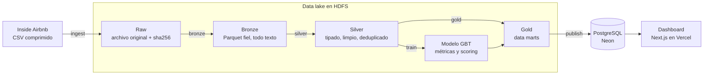

# BigData Airbnb

[](https://github.com/vfernandezg-dev/BIGDATA-AIRBNB/actions/workflows/ci.yml)


Pipeline batch que descarga los datos abiertos de [Inside Airbnb](https://insideairbnb.com/get-the-data/),
los procesa con **Apache Spark sobre HDFS** en capas Bronze, Silver y Gold, entrena un modelo de precios y
publica los resultados en un **dashboard web**: <https://bigdata-airbnb.vfernandezg.dev>

| | |
|---|---|
| Ciudades | 12 (configurable: el catálogo de la fuente tiene 124) |
| Anuncios | 453.343 |
| Filas de calendario procesadas | 165,5 millones |
| Reseñas procesadas | 17,9 millones |
| Datos de origen | 2,6 GB comprimidos, 48 archivos |
| Modelo de precios (conjunto de prueba) | R² 0,83 · error relativo mediano 20,1 % |
| Ejecución completa en un portátil | unos 16 minutos |

## Arquitectura



Cada capa tiene una sola responsabilidad:

| Capa | Qué contiene | Decisión clave |
|---|---|---|
| **Raw** | El archivo de la fuente, sin tocar, con su tamaño y su sha256 | Inside Airbnb solo publica el último snapshot de cada ciudad: esta zona es el archivo histórico |
| **Bronze** | Parquet con todas las columnas como texto, más el archivo y el momento de origen | Solo cambia el formato. Cada archivo se ajusta a un contrato de columnas, así que un cambio de esquema en la fuente no desplaza datos |
| **Silver** | Tablas con tipos, precios en USD, sin duplicados y con flags de calidad | Las filas dudosas no se borran: se etiquetan, y cada consumidor decide qué filtrar |
| **Gold** | Agregados pequeños, uno por pregunta del dashboard | El dashboard nunca toca datos en bruto |

El pipeline es **incremental e idempotente**: cada etapa procesa solo las particiones `(ciudad, snapshot)`
que faltan, y relanzarla no duplica nada.

## Estructura del repositorio

```
conf/                   Configuración: pipeline, ciudades, tipos de cambio y Spark
docker/spark/           Imagen del master, los workers y el driver
docker-compose.yml      HDFS + Spark + driver + PostgreSQL local
src/airbnb_lake/
  cli.py                Etapas: catalog, ingest, bronze, silver, gold, train, publish, run
  config.py             Configuración tipada (YAML + variables de entorno)
  spark.py              Fábrica de la SparkSession
  lake/                 Rutas del lake, sistema de archivos (API de Hadoop) y Parquet
  ingestion/            Catálogo de la fuente y descargas verificadas
  schemas.py            Contratos de columnas de cada archivo
  bronze.py             CSV a Parquet
  silver/               Conversores de tipos, anuncios, calendario y reseñas
  gold/                 Data marts y segmentación de barrios (K-Means)
  ml/                   Variables, entrenamiento y evaluación del modelo
  quality.py            Métricas y validaciones de calidad
  serving/              Esquema SQL y publicación en PostgreSQL
tests/                  94 tests (pytest con Spark en modo local)
dashboard/              Sitio web (Next.js + TypeScript)
legacy/                 Versiones anteriores del proyecto, sin modificar
```

## Requisitos

- **Docker Desktop** con al menos 12 GB de memoria asignada. Es lo único necesario para el pipeline: Spark,
  Hadoop y Python van dentro de los contenedores.
- **Node.js 22 o superior** y **pnpm**, solo para el dashboard.

## Puesta en marcha

```bash
docker compose up -d --build
```

Levanta HDFS (NameNode y DataNode), un cluster Spark standalone (master y dos workers), el contenedor
desde el que se lanzan las etapas y una base PostgreSQL local. Cuando termina:

| Servicio | Dirección |
|---|---|
| HDFS (NameNode) | http://localhost:9870 |
| Spark master | http://localhost:18080 |
| Interfaz de la aplicación Spark en curso | http://localhost:4040 |
| PostgreSQL local | `localhost:5440` |

Los puertos y los recursos de Spark se cambian en un archivo `.env` (ver [`.env.example`](.env.example)).

## Ejecutar el pipeline

```bash
# Todo, de la descarga a la publicación, para las ciudades de conf/cities.yaml
docker compose exec pipeline python3 -m airbnb_lake run

# Una etapa, o un subconjunto de ciudades
docker compose exec pipeline python3 -m airbnb_lake ingest --cities santiago,madrid
docker compose exec pipeline python3 -m airbnb_lake silver --force
```

| Etapa | Qué hace | Tiempo (12 ciudades) |
|---|---|---|
| `catalog` | Muestra qué snapshot publica la fuente para cada ciudad | segundos |
| `ingest` | Descarga a Raw lo que falte, verificando tamaño y sha256 | 2 min |
| `bronze` | CSV comprimido a Parquet | 5 min |
| `silver` | Tipos, precios en USD, deduplicación y flags de calidad | 2 min |
| `gold` | Data marts, segmentación de barrios y validaciones | 2 min |
| `train` | Entrena y evalúa el modelo de precios | 5 min |
| `publish` | Carga los marts en PostgreSQL en una sola transacción | 15 s |
| `run` | Ejecuta todas en orden | 16 min |

Tiempos medidos con 2 workers de 5 núcleos y 2,5 GB cada uno. `--force` reprocesa las particiones aunque
ya existan. `gold`, `train` y `publish` se reconstruyen siempre con las ciudades indicadas.

### Añadir una ciudad

Añade una entrada en [`conf/cities.yaml`](conf/cities.yaml) con la ruta que usa la fuente y vuelve a
ejecutar `run`. Solo se procesa la ciudad nueva:

```yaml
- slug: lima
  name: Lima
  country: Perú
  source_path: peru/lima/lima      # tal cual aparece en insideairbnb.com/get-the-data
  currency: PEN                    # debe existir en conf/fx_rates.yaml
```

`python3 -m airbnb_lake catalog` confirma que la ruta existe antes de descargar nada.

### Cuando la fuente publica un snapshot nuevo

Vuelve a ejecutar `run`. El snapshot nuevo se guarda junto a los anteriores (el lake conserva la historia)
y los marts pasan a reflejar el más reciente de cada ciudad.

## Layout del lake

```
hdfs://namenode:8020/lake/
  raw/insideairbnb/<dataset>/city=<slug>/snapshot_date=<fecha>/<archivo> + _MANIFEST.json
  bronze/<dataset>/city=<slug>/snapshot_date=<fecha>/*.parquet
  silver/<tabla>/city=<slug>/snapshot_date=<fecha>/*.parquet      (zstd)
  gold/<mart>/*.parquet
  models/price/<run_id>/model + metrics.json
```

La raíz es una URI de Hadoop (`lake.root_uri` o la variable `AIRBNB_LAKE_ROOT`): el mismo código funciona
con `hdfs://`, `file://`, `s3a://` o `abfss://`.

## Decisiones de rendimiento

- **Particionado por ciudad y snapshot.** Es la unidad de trabajo incremental y la que permite a Spark
  abrir solo los directorios necesarios. Se escribe con sobrescritura dinámica de particiones.
- **Los `.csv.gz` no son divisibles**, así que Bronze une un DataFrame por archivo en un único plan: Spark
  procesa un archivo por núcleo, en paralelo. A partir de Bronze todo es Parquet, que sí se divide.
- **El calendario se agrega pronto.** Sus 165 millones de filas se reducen a anuncio × mes al pasar a
  Silver, antes de cualquier join.
- **Sin UDF de Python.** Todas las transformaciones son expresiones nativas de Spark y se ejecutan en la
  JVM, sin serializar filas hacia Python.
- **Estadísticas por ciudad en una sola pasada**, con funciones de ventana, en lugar de acciones sueltas
  en el driver.
- **Caché solo donde se reutiliza**: la tabla de anuncios en Gold y el vector de variables durante el
  ajuste del modelo.
- **Recursos fuera del código.** El master y la memoria llegan del entorno (`.env`); el código solo fija
  los ajustes de los que depende que el resultado sea correcto (zona horaria UTC, modo ANSI, sobrescritura
  dinámica).

## Modelo de precios

Un GBT de Spark ML predice el logaritmo del precio por noche a partir de la ciudad, la ubicación, el
tamaño, el tipo de alojamiento, los servicios, el anfitrión y las reseñas. Resultados sobre el 20 % de
anuncios reservado para prueba (69.100 anuncios):

| | Modelo (GBT) | Referencia (mediana por ciudad y tipo) |
|---|---|---|
| R² (sobre el logaritmo) | **0,83** | 0,54 |
| Error relativo mediano | **20,1 %** | 34,5 % |
| Error absoluto medio | **50 USD** | 84 USD |

Por ciudad, el R² va de 0,59 a 0,82. El modelo tiende a quedarse corto en los anuncios más caros y a
pasarse en los más baratos. El reparto entre entrenamiento y prueba es determinista (hash del
identificador) y ninguna variable se deriva del precio: hay una lista explícita de columnas prohibidas y
un test que la comprueba.

## Dashboard

```bash
cd dashboard
cp .env.example .env.local      # apunta a la base PostgreSQL local del stack
pnpm install
pnpm build && pnpm start        # http://localhost:3000
```

Los gráficos usan [Apache ECharts](https://echarts.apache.org/) (mapas de calor de estacionalidad,
burbujas, barras apiladas, rangos de precio) y el mapa, MapLibre GL, con una vista de mapa de calor de
precios y otra de precio por celda.

Las páginas se pre-renderizan a partir de los marts y se sirven desde caché: una visita normal no ejecuta
ninguna consulta. Al terminar de publicar, el pipeline llama a `POST /api/revalidate` y las páginas se
regeneran en la siguiente visita. El sitio se conecta con un rol de solo lectura.

`pnpm e2e` ejecuta las pruebas de humo con Playwright en escritorio, modo oscuro y móvil (la primera vez,
`pnpm exec playwright install chromium`). Con `E2E_BASE_URL` se ejecutan contra un sitio ya desplegado.
Contra producción conviene lanzar un perfil cada vez: el firewall admite 300 peticiones por minuto y por
IP, y la batería completa en paralelo lo supera y recibe respuestas 429.

```bash
E2E_BASE_URL=https://bigdata-airbnb.vfernandezg.dev pnpm e2e --project=escritorio
```

## Publicar en producción

La infraestructura (proyecto de Neon, proyecto de Vercel y DNS) está definida con Terraform en el
repositorio [`vfernandezg-infra`](https://github.com/vfernandezg-dev/vfernandezg-infra), en la stack
`bigdata-airbnb`; su README describe el despliegue paso a paso. El orden es:

1. `terraform apply` crea la base de datos, el proyecto web y el dominio.
2. `publish` carga los marts en Neon. Las variables salen de `terraform output`:

   ```bash
   docker compose exec \
     -e SERVING_DATABASE_URL="<conexión directa del propietario>" \
     -e DASHBOARD_DB_PASSWORD="<contraseña del rol de solo lectura>" \
     -e DASHBOARD_REVALIDATE_URL="https://bigdata-airbnb.vfernandezg.dev/api/revalidate" \
     -e DASHBOARD_REVALIDATE_SECRET="<secreto>" \
     pipeline python3 -m airbnb_lake publish
   ```

3. Se despliega el dashboard con la CLI de Vercel: el build lee los marts ya publicados.

A partir de ahí, cada `publish` actualiza el sitio sin volver a desplegar.

## Calidad

```bash
docker compose exec pipeline bash -c "ruff check src tests && ruff format --check src tests && mypy"
docker compose exec pipeline python3 -m pytest
```

- **94 tests** con Spark en modo local, incluidos un recorrido completo sobre un lake temporal y la
  publicación en PostgreSQL (atomicidad y permisos del rol de solo lectura).
- **Validaciones de datos** que detienen el pipeline antes de publicar: anuncios duplicados, tipos de
  alojamiento inválidos (señal de columnas desplazadas), ciudades sin datos y fechas de calendario
  duplicadas.
- **CI** en GitHub Actions: lint, tipos y tests del pipeline; lint, tipos y build del dashboard.

## Qué cambió respecto a la versión original

| Antes | Ahora |
|---|---|
| 1 ciudad, CSV resumido de 18 columnas | 12 ciudades, archivos detallados de 90 columnas, calendario y reseñas |
| CSV leído sin `multiLine`: el archivo de Santiago tiene 18.904 registros en 32.585 líneas, y las columnas se desplazaban | Lectura conforme al RFC 4180, con un test de regresión |
| pandas cargaba cada CSV en memoria y lo reenviaba fila a fila por Kafka | Descarga en streaming, directa al lake |
| Rutas `C:/airbnb`, tipo de cambio y coordenadas de Santiago en el código | Configuración en YAML y variables de entorno |
| Sin capa Silver ni particionado; reejecutar duplicaba datos | Capas persistidas, particionadas e idempotentes |
| Modelo con R² −0,01 | R² 0,83, sin fuga del objetivo |
| Power BI abriendo un archivo Parquet a mano | Sitio web con datos pre-agregados y caché |
| Sin tests, tipos ni configuración | 94 tests, `mypy` estricto, `ruff` y CI |

El código anterior se conserva en [`legacy/`](legacy/).

## Límites conocidos

- Los precios son los anunciados, y muchos anuncios no publican precio (en París, el 44 %): las
  estadísticas de precio y el modelo usan solo los que sí.
- La conversión a USD usa un tipo de cambio fijo ([`conf/fx_rates.yaml`](conf/fx_rates.yaml)), para que
  repetir una corrida dé el mismo resultado.
- La ocupación es una estimación de Inside Airbnb a partir de las reseñas.
- El cluster local tiene un solo DataNode (factor de réplica 1): sirve para desarrollar y demostrar, no
  para conservar datos.

## Solución de problemas

| Síntoma | Causa y arreglo |
|---|---|
| `ports are not available` al levantar el stack | El puerto ya está en uso. Cambia `HDFS_UI_PORT`, `SPARK_MASTER_UI_PORT`, `SPARK_DRIVER_UI_PORT` o `SERVING_DB_PORT` en `.env` |
| Un worker se reinicia durante `bronze` o `train` | Falta memoria. Sube la asignada a Docker, o baja `SPARK_WORKER_CORES` y `SPARK_EXECUTOR_MEMORY` en `.env` |
| `El catálogo no publica: ...` | La ruta de la ciudad en `cities.yaml` no coincide con la de la fuente. Compárala con `python3 -m airbnb_lake catalog` |
| En Git Bash, `hdfs dfs -ls /lake` falla con `No FileSystem for scheme "C"` | Git Bash convierte las rutas. Antepón `MSYS_NO_PATHCONV=1` o usa PowerShell |

## Datos y créditos

Los datos son de [Inside Airbnb](https://insideairbnb.com/), bajo licencia
[Creative Commons Atribución 4.0](https://creativecommons.org/licenses/by/4.0/deed.es). El dashboard no
publica nombres de anfitriones ni el texto de las reseñas. Este proyecto no está afiliado a Airbnb, Inc.
ni a Inside Airbnb.

Nació como trabajo del curso de Big Data de la Universidad Privada Antenor Orrego; la primera versión y
su autoría están en [`legacy/version_1/`](legacy/version_1/README.md).
